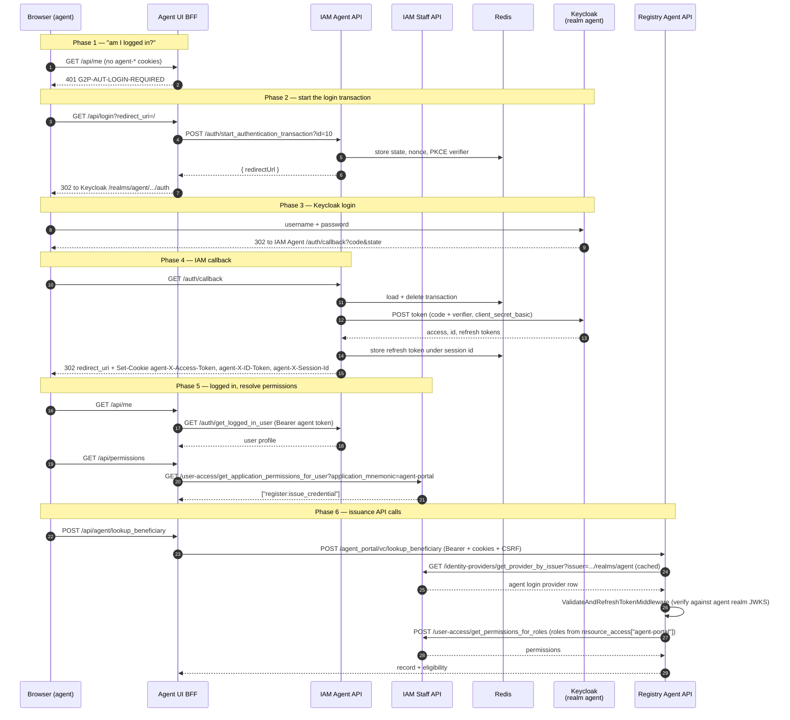

# Agent Portal Login Flow (Agent UI → Agent IAM → Keycloak `agent` realm)

How a field agent logs in to the agent portal, how this differs from the staff login, and how the login connects to verifiable credential (VC) issuance.

Companion to [staff-portal-login-flow.md](staff-portal-login-flow.md). Read that first. The agent login reuses the same `iam_core` machinery, so this document only describes what is different.

How this was verified:

- **Code only.** No live trace. The local openg2p-developer stack does not run the agent portal, the `agent` realm, Inji Certify or the eSignet registrant-auth setup yet.
- **IAM** `iam-service`, branch `1.4` at `a073fa2` (2026-10-08): `iam-agent-portal-api/src/iam_agent_portal_api/{app,config}.py`, `controllers/auth_controller.py`, `data/data_loader.py`, `iam-core/src/iam_core/user_auth/{decorators,middleware/resolve_permissions}.py`, `deployments/charts/openg2p-iam-service/values.yaml`.
- **Registry** `registry-platform`, branch `develop` at `09365e5` (2026-08-25): `apis/openg2p-registry-agent-portal-api/` (`main.py`, `app.py`, `controllers/vc_issuance_controller.py`, `services/*`), `ui/agent-ui/src/app/api/` (BFF routes and `_lib/`), `helm/openg2p-registry/values.yaml`, `helm/openg2p-registry/files/iam-registration/agent-payload.json`. This code is **not** on the `1.2` release branch.

Status: all agent work was written under ticket G2P-4929 between 2026-08-20 and 2026-08-24. Both switches are off by default: `agentPortalApi.enabled` and `agentPortalApi.vcIssuance.enabled` in the registry chart. `iamAgentPortalApi.enabled` is on by default in the IAM chart.

## Components

| Name | Chart / service | What it is |
|---|---|---|
| Browser | — | The field agent's browser |
| Agent UI (BFF) | `registry-platform` `ui/agent-ui` | Next.js app. The staff portal UI model: server-side route handlers hold the session, and the browser never sees a token |
| IAM Agent Portal API | `iam-service` `iam-agent-portal-api` | OIDC confidential client for the `agent` realm. Runs the login, sets the cookies, owns the refresh tokens |
| IAM Staff Portal API | `iam-service` `iam-staff-portal-api` | Used by the agent flow **only** for roles → permissions (`/user-access/*`). That code exists only here |
| IAM database | shared | One `login_providers` table for both IAM APIs. The agent row is `id: 10`, `user_type: agent` |
| Redis | shared | Login transactions and refresh tokens (IAM), and the registrant-auth session store (registry) |
| Keycloak | realm `agent`, client `agent-portal` | Identity provider for agents. Plain password login |
| Registry Agent Portal API | `registry-platform` `openg2p-registry-agent-portal-api` | Issuance backend. Validates the agent token itself and enforces `register:issue_credential` |
| eSignet | — | Authenticates the **beneficiary** during issuance. Not used for the agent's own login |
| Inji Certify | `commons-services-inji-certify` | Signs the credential |

## Sequence diagram

## Step by step

### Phase 1 — profile check

`/api/me` runs `requireAuth` (`ui/agent-ui/src/app/api/_lib/requireAuth.ts`). This check reads cookies only and makes no backend call:

- No `agent-X-Access-Token` and no `agent-X-ID-Token`: returns `401 G2P-AUT-LOGIN-REQUIRED`.
- An ID token but no access token: returns `413 G2P-AUT-413`. This is the same "too many roles, token too big" case as staff.

### Phase 2 — start the login transaction

`/api/login` is identical to the staff hub's route. It calls `POST {IAM_URL}/auth/start_authentication_transaction?id={LOGIN_PROVIDER_ID}` and redirects the browser to the returned `redirectUrl`.

- `IAM_URL` is the **agent** IAM (`global.agentIamPublicUrl`, default `https://agent-iam.<ns>.openg2p.org`). It is not the staff IAM host.
- `LOGIN_PROVIDER_ID` is `10`. Staff is `1`. This value must match `iamAgentPortalApi.loginProviders[0].id` in the IAM chart.

The agent IAM also has `GET /auth/get_login_provider_redirect/{id}`, which staff does not have. This route does the same thing in one hop: it starts the transaction and returns a 302. The agent UI does not use it.

### Phase 3 — Keycloak login

The `agent` realm, client `agent-portal`, scope `openid profile email`, PKCE on, `client_secret_basic`. This is a plain Keycloak username and password form. The registry chart seeds a demo `agent` user with password `global.agentUserPassword` (default `pass`).

### Phase 4 — IAM callback

The same `iam_core` code as staff (`AuthService.complete_authentication_transaction`, `store_refresh_token`, `set_auth_cookies`). One structural difference: on staff, `/auth/callback` lives in a separate `OAuthCallbackController`. On the agent API it is a method on `AuthController`.

Cookies are prefixed with `agent-` (`IAM_AGENT_AUTH_COOKIE_PREFIX`, read by `iam_core` as `auth_cookie_prefix`). This keeps the agent session separate from the staff session on the shared parent domain. Without the prefix, a browser logged in to both portals sends the staff ID token next to the agent access token. The registry agent API cannot verify that staff token against the agent realm. The agent UI BFF rewrites `Set-Cookie` `Domain` to `COOKIE_DOMAIN` (`.<ns>.openg2p.org`).

The CSRF cookie name is the same for both portals. The agent IAM runs `CsrfMiddleware` with the same excluded paths as staff (`IAM_AGENT_CSRF_EXCLUDED_PATHS` in `app.py`).

### Phase 5 — logged in, permissions

- `/api/me` calls `GET {agent IAM}/auth/get_logged_in_user`.
- `/api/permissions` calls the **staff** IAM: `GET {AUTH_PROVIDER_API_URL}/user-access/get_application_permissions_for_user?application_mnemonic={APPLICATION_MNEMONIC}`.

Why the staff IAM: the `/user-access/*` routes exist only in `iam-staff-portal-api`. The staff IAM accepts the agent token because it resolves the token `iss` against the shared `login_providers` table, and the agent row is in that table.

`APPLICATION_MNEMONIC` must equal the Keycloak client id the roles sit under (`global.agentKeycloakClientId`, default `agent-portal`). IAM reads `resource_access[application_mnemonic]` from the token and then looks up the IAM application with the same mnemonic. If either half is missing, the call returns `[]` with status 200, and the portal quietly refuses to issue. The registry chart's iam-register job creates the IAM application from `files/iam-registration/agent-payload.json`. That payload defines a single permission and a single role, both named `register:issue_credential`.

### Phase 6 — registry API calls

The BFF proxies `/api/agent/<endpoint>` to `{BACKEND_API_URL}/agent_portal/vc/<endpoint>` (`_lib/agent-proxy.ts`). It wraps the body in the G2P request envelope and sends `Authorization: Bearer`, the `agent-*` cookies and the CSRF header.

The registry agent API middleware chain (`main.py`), from outermost to innermost:

1. `AuditMiddleware`: records actor and outcome to the Audit Manager.
2. `ValidateAndRefreshTokenMiddleware`: validates the token against the `agent` realm and refreshes it from the session cookie when needed. Token cookies are read with prefix `agent-` (`REGISTRY_AGENT_PORTAL_API_AUTH_COOKIE_PREFIX`). To map the token `iss` to a login provider, `ProviderRepository.get_by_iss` first tries a local `login_providers` table. The registry DB has none, so it falls back to `GET {auth_provider_api_url}/identity-providers/get_provider_by_issuer` on the **staff** IAM, and caches the result. The signature is then verified locally against the `agent` realm JWKS. This is the second reason the agent row must be in the staff IAM's table: without it, every registry call fails with 401 "Unknown Issuer".
3. `ResolvePermissionMiddleware` (`client_id = agent-portal`, `allow_by_default=True`): takes the roles from `resource_access["agent-portal"]` and calls `POST {auth_provider_api_url}/user-access/get_permissions_for_roles` on the staff IAM. It then checks them against the route's `@require_permissions`.

Every issuance route requires `register:issue_credential`. `@require_permissions` only attaches metadata. The middleware is what enforces it, so the routes are open if the middleware is missing.

`AGENT_CSRF_EXCLUDED_PATHS` on the registry agent API is short: `/ping`, `/openapi.json`, `/docs`, `/redoc`, `/docs/oauth2-redirect`. The eSignet callback does not land on this API (see below).

### Phase 7 — logout

`/api/logout` redirects to `{agent IAM}/auth/logout`. This is the same front-channel logout as staff: it deletes the refresh token, clears the cookies, and redirects to the `agent` realm's `end_session_endpoint` with `id_token_hint`.

**There is no backchannel logout.** The agent IAM has no `POST /auth/backchannel-logout`. If the Keycloak session ends any other way (admin kill, SSO logout elsewhere, idle timeout), the agent IAM keeps the refresh token until it expires. To add it, copy the staff route, add the path to `IAM_AGENT_CSRF_EXCLUDED_PATHS`, and set the backchannel logout URL on the `agent-portal` client.

## Staff vs agent at a glance

| | Staff | Agent |
|---|---|---|
| UI | Staff portal hub | `registry-platform` `ui/agent-ui` (same BFF model) |
| IAM API that runs the login | `iam-staff-portal-api` | `iam-agent-portal-api` |
| Keycloak realm / client | `staff` / `staff-portal` | `agent` / `agent-portal` |
| `login_providers` row | `id: 1`, `user_type: staff` | `id: 10`, `user_type: agent` |
| Env prefix (IAM) | `IAM_STAFF_` | `IAM_AGENT_` |
| Cookie names | `X-Access-Token`, `X-ID-Token`, `X-Session-Id` | `agent-X-Access-Token`, `agent-X-ID-Token`, `agent-X-Session-Id` |
| Roles → permissions | Staff IAM `/user-access/*` | Also the **staff** IAM `/user-access/*` |
| Admin APIs (applications, roles, data policies, login provider CRUD) | Yes | None |
| `get_login_provider_redirect/{id}` | No | Yes |
| Backchannel logout | Yes | No |
| IAM data seeding | Full data loader | Only its own `login_providers` row, matched by `issuer` so it never overwrites the staff row |

The chart comments say "a staff token grants nothing on an agent API and vice versa". That is true for the **registry agent API**, which validates against the `agent` realm and checks `resource_access["agent-portal"]`. It is **not** true for the staff IAM, which accepts agent tokens because both issuers sit in the shared `login_providers` table. The agent flow depends on this for permission resolution.

## Where the login leads: VC issuance

Once logged in with `register:issue_credential`, the agent issues a credential in 4 calls under `/agent_portal/vc` (`controllers/vc_issuance_controller.py`):

1. `lookup_beneficiary`: the agent enters a national ID. The registry finds the record and returns `internal_record_id` and `eligible`/`reason`.
2. `start_authentication`: the registry starts a registrant-authentication transaction against eSignet and returns `authorization_url`. The beneficiary authenticates at eSignet and approves the eSignet consent screen. The agent is recorded as `initiated_by_staff_id`. Core refuses to complete if the eSignet token subject is not the record's `foundational_id`.
3. `authentication_status`: the UI polls until `authorised=true`.
4. `issue`: the API checks the beneficiary authentication again. The authentication must be younger than `vc_auth_window_seconds` (default 300) measured from `completed_at`. The API then reads claims from the manifestation's VC view and gets the credential signed by Inji Certify through the pre-authorized-code flow. It renders a PDF with the QR at `claim169.qrCode`, writes an issuance log entry, and returns the PDF.

So 2 people are authenticated, in 2 different systems:

| Who | Where | How |
|---|---|---|
| Agent | Keycloak `agent` realm through the agent IAM | Password login, token on every call |
| Beneficiary | eSignet, started by the registry | eSignet auth + consent, valid for 5 minutes for issuance |

### eSignet callback lands on the staff API

`oauth_callback_url` for registrant authentication points at the registry **staff** API, not the agent API. So the transaction is started in the agent API pod and completed in a staff API pod. Both must share the registrant-auth session store. The chart sets `REGISTRY_CORE_REGISTRANT_AUTH_SESSION_STORE_BACKEND=redis` and `REGISTRY_CORE_REGISTRANT_AUTH_REDIS_URL` for this. With the default in-process store, every beneficiary authentication fails.

## Configuration that must line up

If any of these do not match, login or issuance fails, often quietly:

| Setting | Must equal |
|---|---|
| Agent UI `LOGIN_PROVIDER_ID` (`10`) | IAM chart `iamAgentPortalApi.loginProviders[0].id` |
| Agent UI `IAM_URL` | Public URL of `iam-agent-portal-api` (`global.agentIamPublicUrl`) |
| Agent UI `APPLICATION_MNEMONIC` | Keycloak client id the roles sit under (`agent-portal`) and the IAM application mnemonic registered by `agent-payload.json` |
| Registry `REGISTRY_AGENT_PORTAL_API_KEYCLOAK_CLIENT_ID` | `IAM_AGENT_KEYCLOAK_CLIENT_ID` and the agent login provider's `clientId` |
| Registry `REGISTRY_AGENT_PORTAL_API_AUTH_COOKIE_PREFIX` (`agent-`) | `IAM_AGENT_AUTH_COOKIE_PREFIX` |
| Agent UI `AUTH_PROVIDER_API_URL` and registry `REGISTRY_AGENT_PORTAL_API_AUTH_PROVIDER_API_URL` | The **staff** IAM service URL |
| `agentPortalHostname` | A registered redirect URI on the `agent-portal` client |
| Registrant-auth session store | Redis, shared by the agent API and staff API pods |

The IAM agent API starts even when the `agent` realm does not exist yet. It seeds the provider row, and the client secret mount is optional. Login only works after the realm and client exist.

Without the agent `login_providers` row, `iam_core` cannot resolve the agent token issuer, and every authenticated agent call returns 401 (`data/data_loader.py` docstring).

## Known gaps

- No backchannel logout on the agent IAM (see Phase 7).
- Issuer resolution and permission resolution both depend on the staff IAM (`/identity-providers/get_provider_by_issuer` and `/user-access/*`). Neither route exists on the agent IAM. This is why the agent IAM shares the staff IAM's database and `login_providers` table instead of using its own. The agent portal cannot authenticate or authorize anything at the registry without the staff IAM.
- The staff IAM accepts any valid token from any issuer in `login_providers`, because both chart templates set `audiences` to empty and the audience check is skipped (`iam_core/services/token_validator_service.py:35`). `get_permissions_for_roles` has no auth decorator.
- `/api/permissions` returns `[]` with status 200 when the mnemonic or IAM application is wrong, and the UI shows no error.
- Not exercised locally. Each step above comes from reading the code. Running it needs the `agent` realm and client, the IAM agent API, the registry agent API and agent UI, eSignet registrant auth, and Inji Certify.
