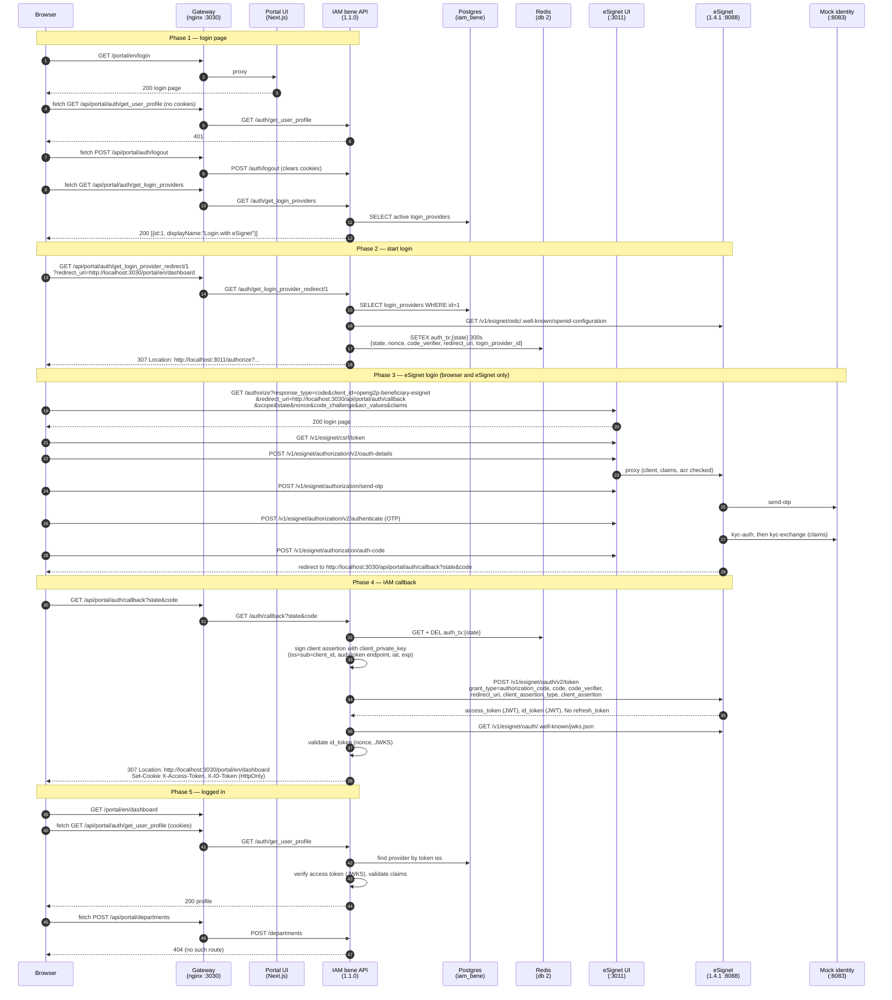

# Beneficiary Portal Login Flow (Portal UI → IAM bene API → eSignet)

Exact login route as observed in the local openg2p-developer Docker stack on 2026-10-20, using the versions OpenG2P deploys together.

How this was verified:

- **Live login in a browser**: a full login at `http://localhost:3030/portal` with the mock identity `8267411072` and OTP `111111`, ending on the dashboard. The request sequence below comes from the nginx gateway access log, the eSignet UI (nginx) access log, and the IAM and eSignet application logs for that login (09:20:38 to 09:20:53 UTC).
- **Code**: IAM `openg2p-iam-service` tag `v1.1.0` (running image `openg2p/iam-bene-portal-api:1.1.0`) — `iam-bene-portal-api/.../controllers/auth_controller.py`, `iam-core/src/iam_core/services/{auth_service,redis_auth_transaction_store,token_validator_service}.py`, `user_auth/{dependencies,oidc_client}.py`, `user_auth/helpers/client_assertion_helper.py`, `user_auth/adapters/implementations/esignet_adapter.py`. eSignet `mosip/esignet` tag `v1.4.1` — `OAuthServiceImpl`, `TokenServiceImpl`, `CacheUtilService`, `docker-compose/config/esignet-default.properties`.
- **Live database**: the IAM `iam_bene.login_providers` row and the eSignet `client_detail` record were read and written directly.

Items marked *(code only)* were read in source but not exercised in the live login.

## Versions

The current IAM (`iam-bene-portal-api` 1.2 and later) and the Go eSignet 2.0.0 do not complete this login. See the findings linked at the end. This stack uses:

| Component | Version | Source |
|---|---|---|
| eSignet service, login UI | `mosipid/esignet:1.4.1`, `mosipid/oidc-ui:1.4.1` | `mosip/esignet` tag `v1.4.1`; pinned by `OpenG2P/openg2p-deployment` `charts/esignet` |
| Mock identity system | `mosipid/mock-identity-system:0.9.3` | pinned by `OpenG2P/openg2p-deployment` `charts/mock-identity-system` |
| IAM bene API | `openg2p/iam-bene-portal-api:1.1.0` | `OpenG2P/openg2p-iam-service` (archived) tag `v1.1.0` |
| Beneficiary Portal UI | `openg2p/openg2p-beneficiary-portal-ui:local` | built from `OpenG2P/openg2p-beneficiary-portal-ui` commit `6ee484c` |

## Components

| Name | Container | Port | What it is |
|---|---|---|---|
| Browser | — | — | The user's browser |
| Gateway | `openg2p-bene-gateway` | 3030 | nginx. `/portal` → UI, `/api/portal/` → IAM bene API (prefix stripped). `config/bene/gateway.conf` |
| Portal UI | `openg2p-bene-portal-ui` | 3000 (internal) | Next.js app, base path `/portal`, API base path `/api/portal` |
| IAM bene API | `openg2p-iam-bene-api` | 8021 → 8000 | Runs the OIDC login against eSignet, sets the session cookies, validates tokens |
| Postgres | `openg2p-postgres` | 5433 | DB `iam_bene`, table `login_providers` |
| Redis | `openg2p-redis` | 6379 | DB 2: login transactions |
| eSignet login UI | `esignet-java-esignet-ui-1` | 3011 → 3000 | MOSIP `oidc-ui`. Serves `/authorize` and proxies `/v1/esignet/*` to the service |
| eSignet service | `esignet-java-esignet-1` | 8088 | MOSIP eSignet 1.4.1 (Java). OIDC provider |
| Mock identity system | `esignet-java-mock-identity-system-1` | 8083 → 8082 | Stands in for the national ID system: holds identities, checks OTP, returns KYC claims |
| eSignet support | `esignet-java-database-1`, `-artifactory-server-1`, `kafka`, `zookeeper` | 5455, internal | eSignet's own Postgres, plugin and i18n file server, and the message bus for wallet (QR) login |

## Sequence diagram



## Step-by-step, with observed values

### Phase 1 — login page

1. The browser opens `http://localhost:3030/portal`. The gateway redirects `/` to `/portal` (302), and the UI redirects to the locale path `/portal/en/...`.
2. The UI calls `GET /api/portal/auth/get_user_profile` from the browser. The gateway forwards it to IAM. Without cookies IAM answers `401`.
3. On `401` the UI calls `POST /api/portal/auth/logout` (IAM deletes the cookies, which do not exist yet) and shows the login page.
4. The login page calls `GET /api/portal/auth/get_login_providers`. IAM answers `{"loginProviders":[{"id":1,"name":"eSignet","protocol":"oidc","displayName":"Login with eSignet","displayIconUrl":""}]}`. The UI shows one button per provider.

All portal calls to IAM go **from the browser through the gateway**. The UI has no server-side login route, unlike the staff hub.

### Phase 2 — start the login transaction

5. Clicking the button navigates the browser to `GET /api/portal/auth/get_login_provider_redirect/1?redirect_uri=http://localhost:3030/portal/en/dashboard`. `1` is the login provider ID. `redirect_uri` is the **app return URL**.
6. IAM loads provider `1` from `iam_bene.login_providers`, fetches eSignet's discovery document, and creates a transaction in Redis:
   - key `auth_tx:{state}` in Redis DB 2, TTL **300 s**
   - fields: `state`, `nonce`, `code_verifier`, `redirect_uri`, `login_provider_id`
7. IAM builds the eSignet authorize URL from the row's `authorization_endpoint`, `client_id`, `oauth_callback_url`, `scope`, PKCE and `extra_authorize_params`, and answers `307` with that URL. The `esignet` adapter JSON-encodes the `claims` parameter.

### Phase 3 — eSignet login

8. The browser follows the 307 to the eSignet login UI:
   ```
   http://localhost:3011/authorize
     ?response_type=code
     &client_id=openg2p-beneficiary-esignet
     &redirect_uri=http://localhost:3030/api/portal/auth/callback
     &scope=openid profile email
     &state=...&nonce=...&code_challenge=...&code_challenge_method=S256
     &acr_values=mosip:idp:acr:generated-code mosip:idp:acr:biometrics
     &claims={"userinfo":{"name":{"essential":true},"gender":{"essential":true},"birthdate":{"essential":true},...}}
   ```
9. The login UI calls eSignet through its own nginx proxy (`/v1/esignet/*` on `:3011` → service `:8088`). Observed, all `200`:
   1. `GET /v1/esignet/csrf/token`
   2. `POST /v1/esignet/authorization/v2/oauth-details`. eSignet checks the client, redirect URI, ACR values and claims, and starts a transaction.
   3. `POST /v1/esignet/authorization/send-otp`. eSignet asks the mock identity system to send an OTP. The mock's OTP is `111111`.
   4. `POST /v1/esignet/authorization/v2/authenticate`. eSignet checks the OTP with the mock (`kyc-auth`) and gets the user's claims (`kyc-exchange`).
   5. `POST /v1/esignet/authorization/auth-code`. eSignet issues a one-time code.
10. The UI sends the browser to the OAuth `redirect_uri`:
    ```
    http://localhost:3030/api/portal/auth/callback
      ?state=...   (same value IAM generated)
      &code=...    (one-time authorization code)
    ```

### Phase 4 — IAM callback

11. The gateway forwards to IAM `GET /auth/callback`. IAM finds the login by `state` only: it reads and deletes `auth_tx:{state}` (`get_and_pop`). Unknown or expired state is rejected.
12. IAM builds a **client assertion**, a JWT signed with the provider row's `client_private_key` (RS256):
    - header `{"alg":"RS256","typ":"JWT"}`, no `kid`
    - claims `iss` and `sub` = `openg2p-beneficiary-esignet`, `aud` = `http://localhost:8088/v1/esignet/oauth/v2/token` (the token endpoint, because `jwt_assertion_aud` is empty), `iat`, `exp` = now + 1 h. No `jti`.
13. IAM exchanges the code server-to-server: `POST http://localhost:8088/v1/esignet/oauth/v2/token` with a form body of `grant_type=authorization_code`, `code`, `code_verifier`, `redirect_uri`, `client_id`, `client_assertion_type=urn:ietf:params:oauth:client-assertion-type:jwt-bearer` and `client_assertion`. eSignet looks up the code first, then verifies the assertion against the public JWK registered for the client.
14. eSignet returns an `access_token` and an `id_token`, both JWTs. **No `refresh_token`**: eSignet allows only the `authorization_code` grant.
15. IAM calls `validate_callback_id_token` on the ID token with the stored `nonce`, using eSignet's JWKS (`/v1/esignet/oauth/.well-known/jwks.json`) *(code only for the exact checks)*.
16. IAM answers `307 Location: http://localhost:3030/portal/en/dashboard` (the app return URL from step 6) and sets:

| Cookie | Value | HttpOnly | Max-Age | Domain / Path |
|---|---|---|---|---|
| `X-Access-Token` | eSignet access token JWT | yes | 1800 | `localhost` / `/` |
| `X-ID-Token` | eSignet ID token JWT | yes | 1800 | `localhost` / `/` |

`Expires` is also set from the token response's `expires_in` (`IAM_BENE_AUTH_COOKIE_SET_EXPIRES=true`). `Secure` is off locally (`IAM_BENE_AUTH_COOKIE_SECURE=false`).

### Phase 5 — logged in

17. The browser loads `/portal/en/dashboard`. Each page calls `GET /api/portal/auth/get_user_profile`, now with the cookies. Observed: `200`.
18. IAM's auth dependency takes the token from the `Authorization` header or, failing that, the `X-Access-Token` cookie, plus `X-ID-Token`. `token_validator_service.validate`:
    - reads `iss` from the token without verifying it, and finds the login provider whose `issuer` equals it exactly. No match gives `401 Unknown Issuer`.
    - checks `aud` only if the row has `audiences` (empty here)
    - verifies the access token and ID token signatures against the provider's JWKS
    - runs the `esignet` adapter's claim check: `individual_id` or `sub` must be present
19. The profile is built from the token claims. eSignet's userinfo endpoint is **not** called: the `esignet` adapter has `enrich_claims_from_userinfo`, but nothing in 1.1.0 calls it *(code only)*.
20. Each page also calls `POST /api/portal/departments`, which returns `404`: IAM has no such route. The UI keeps working.

### Phase 6 — logout *(code only)*

21. `POST /api/portal/auth/logout` deletes the two cookies and nothing else. IAM 1.1.0 holds no server-side session and does not redirect to eSignet. In the observed logins eSignet asked for the OTP again each time.

## Cookies and sessions

| | eSignet | IAM |
|---|---|---|
| Session state | In-memory caches in the eSignet service (`spring.cache.type=simple`): login transaction, authenticated user, auth code, cached userinfo | Two cookies in the browser. Nothing on the server after the callback |
| Lifetime | Access and ID token 3600 s; cached userinfo the same | Cookie `Max-Age` 1800 s |
| Refresh | None | None: the user logs in again when the cookie expires |

Compared with the staff flow: there is no `X-Session-Id`, no `X-CSRF-Token`, and no `refresh_token:{sid}` key in Redis. Those came with IAM 1.2 (G2P-5161), which also made a refresh token mandatory. See [iam-refresh-token-required.md](iam-refresh-token-required.md).

## Two different `redirect_uri` values

| | Value | Set where | Used by |
|---|---|---|---|
| App return URL | `http://localhost:3030/portal/en/dashboard` | UI → `get_login_provider_redirect` → stored in `auth_tx:{state}` | IAM, final 307 after the callback |
| OAuth `redirect_uri` | `http://localhost:3030/api/portal/auth/callback` | `login_providers.oauth_callback_url` | eSignet, to deliver the code. Must be in the eSignet client's `redirectUris` |

The OAuth callback goes through the gateway (`:3030`), so IAM's cookies are set on the same origin as the portal.

## Redis keys

| Key | Created | Deleted | TTL |
|---|---|---|---|
| `auth_tx:{state}` (DB 2) | `get_login_provider_redirect` | `/auth/callback` (`get_and_pop`) | 300 s |

## The login provider row

`iam_bene.public.login_providers`, `id = 1`, as used for this login. Unlike the staff Keycloak row, the endpoints are set explicitly, because eSignet 1.4.1's discovery document does not match its tokens (see 1b and 1c in [esignet-1.4.1-compose-config-issues.md](esignet-1.4.1-compose-config-issues.md)).

| Field | Value | Meaning |
|---|---|---|
| `provider_name` | eSignet | Display name |
| `description` | Login with eSignet | Button text |
| `adapter_name` | `esignet` | JSON-encodes `claims` in the authorize URL; requires `individual_id` or `sub` |
| `client_id` | `openg2p-beneficiary-esignet` | IAM's identity at eSignet |
| `token_endpoint_auth_method` | `private_key_jwt` | eSignet supports nothing else |
| `client_private_key` | RSA private key, PEM as bytes | Signs the client assertion. The only secret in the row |
| `server_metadata_url` | `http://localhost:8088/v1/esignet/oidc/.well-known/openid-configuration` | Discovery |
| `authorization_endpoint` | `http://localhost:3011/authorize` | The login UI's host, not the service host that discovery reports |
| `token_endpoint` | `http://localhost:8088/v1/esignet/oauth/v2/token` | Also the assertion `aud`, because `jwt_assertion_aud` is empty |
| `userinfo_endpoint` | `http://localhost:8088/v1/esignet/oidc/userinfo` | Not called in 1.1.0 |
| `jwks_uri` | `http://localhost:8088/v1/esignet/oauth/.well-known/jwks.json` | Verifies eSignet's tokens |
| `jwt_assertion_aud` | empty | Falls back to `token_endpoint`, which eSignet 1.4.1 expects |
| `issuer` | `http://localhost:8088/v1/esignet` | Must equal the token's `iss`. Discovery says `http://localhost:8088`, which does not match |
| `audiences` | empty | `aud` not checked |
| `scope` | `openid profile email` | |
| `enable_pkce` | `true` | Sends `code_challenge` / `code_verifier` |
| `extra_authorize_params` | `acr_values` = `mosip:idp:acr:generated-code mosip:idp:acr:biometrics`; `claims.userinfo` = name, gender, birthdate essential; phone_number, email, address, picture optional | Passed to `/authorize` |
| `oauth_callback_url` | `http://localhost:3030/api/portal/auth/callback` | The OAuth `redirect_uri` |
| `default_redirect_uri` | `http://localhost:3030/portal` | App return URL when the UI passes none |
| `active` | `true` | Offered on the login page |

IAM resolves every token **by `issuer`**, so two rows must not share an issuer.

## The eSignet client

Registered with `POST http://localhost:8088/v1/esignet/client-mgmt/oidc-client` (body shape from the `v1.4.1` Postman collection `docs/postman-collections/esignet-with-mock-IDA.postman_collection.json`). The bundled config does not require a token for client management.

| Field | Value |
|---|---|
| `clientId` | `openg2p-beneficiary-esignet` |
| `relyingPartyId` | `openg2p` |
| `publicKey` | The public JWK for `client_private_key`, `kid` `openg2p-beneficiary-esignet-key`, RS256 |
| `redirectUris` | `http://localhost:3030/api/portal/auth/callback` |
| `grantTypes` | `authorization_code` |
| `clientAuthMethods` | `private_key_jwt` |
| `authContextRefs` | `mosip:idp:acr:generated-code`, `mosip:idp:acr:biometrics`, `mosip:idp:acr:linked-wallet` |
| `userClaims` | name, email, gender, phone_number, picture, birthdate, address |
| Status | `ACTIVE` |

The ACR values and claims requested in the authorize URL must be a subset of these.

## The test identity

Created with `POST http://localhost:8083/v1/mock-identity-system/identity` using the Postman collection's "Create Mock Identity" body: `individualId` `8267411072`, `pin` `111111`, name "Siddharth K Mansour", male, born 1987/11/25, an encoded photo (required). The mock accepts OTP `111111`.

## What the portal can and cannot show

- Login, profile and logout go through IAM, and work.
- `POST /api/portal/departments` returns 404 on every page. No departments service is running.
- Program, application, SPAR bank account and news pages call PBMS, SPAR and Strapi, which are not running in this stack. The registries page shows sample data built into the UI.
- No beneficiary or registrant record is created at login. IAM only authenticates.

## Troubleshooting seen locally

| Symptom | Cause | Fix |
|---|---|---|
| `localhost:3030` redirects to `localhost/portal` (port lost) | nginx absolute redirects use the container's port 80 | `absolute_redirect off;` and a 302 in `gateway.conf` |
| eSignet `send-otp` returns 500, eSignet log `NullPointerException` in `CacheUtilService.getApiRateLimitTransaction` | `apiRateLimit` and `blocked` missing from `mosip.esignet.cache.names` in the bundled config | Add them and restart eSignet ([1a](esignet-1.4.1-compose-config-issues.md)) |
| Callback: `token_endpoint (or jwt_assertion_aud) is required for client assertion.` | Endpoints not set on the provider row. IAM does not take them from discovery | Set `token_endpoint` and the other endpoints on the row |
| Callback: `G2P-REQ-100 Unknown Error`, IAM log `invalid_client: Invalid client assertion` | Go eSignet 2.0.0 requires `jti` and `kid`, which IAM does not send | Use eSignet 1.4.1 ([client assertion finding](esignet-token-exchange-client-assertion.md)) |
| Callback: `G2P-AUT-401 Missing refresh_token in token response.` | IAM 1.2 and later require a refresh token; eSignet issues none | Use IAM bene API 1.1.0 ([finding](iam-refresh-token-required.md)) |
| Callback: `401` on a second try with the same URL | The `state` was already used, or the code expired | Start a new login |
| `get_user_profile` 401 after login, IAM log `Unknown Issuer. http://localhost:8088/v1/esignet` | Row `issuer` copied from discovery, which differs from the token `iss` | Set `issuer` to the token's value ([1b](esignet-1.4.1-compose-config-issues.md)) |
| eSignet slow to answer after a restart | amd64 images run under emulation on Apple silicon. First start about 10 min, later restarts about 1 min | Wait for `Started EsignetServiceApplication` in its log |

## Known gaps and issues found

- **IAM 1.2+ and eSignet do not work together**: mandatory refresh token in IAM, none from eSignet. Tracked in [iam-refresh-token-required.md](iam-refresh-token-required.md).
- **IAM never sends `jti` or `kid`** in the client assertion, which eSignet Java 1.6+ (`jti`) and Go 2.0.0 (`jti` and `kid`) require. Tracked in [esignet-token-exchange-client-assertion.md](esignet-token-exchange-client-assertion.md).
- **eSignet 1.4.1 bundled compose config**: two cache names missing, and the discovery `issuer` and `authorization_endpoint` are wrong. Tracked in [esignet-1.4.1-compose-config-issues.md](esignet-1.4.1-compose-config-issues.md).
- **No refresh, short session**: the session ends when the 30-minute cookie expires. Why eSignet issues no refresh token: [esignet-no-refresh-token.md](esignet-no-refresh-token.md).
- **App return URL is not validated** by IAM: `get_login_provider_redirect` accepts any `redirect_uri` *(code only)*. Possible open redirect after login, as in the staff flow.
- **Host port 8021 resets connections**: `curl localhost:8021` fails, while the gateway reaches IAM on the Docker network. Not investigated.
- **Logout does not reach eSignet**: IAM 1.1.0 only deletes its cookies. Each observed login asked for the OTP again, so no eSignet session was reused. Not checked whether eSignet keeps one.
- **Profile has only token claims**: userinfo (name, gender, birthdate) is not fetched in 1.1.0, so the profile shows what the access token and ID token carry *(code only)*.
