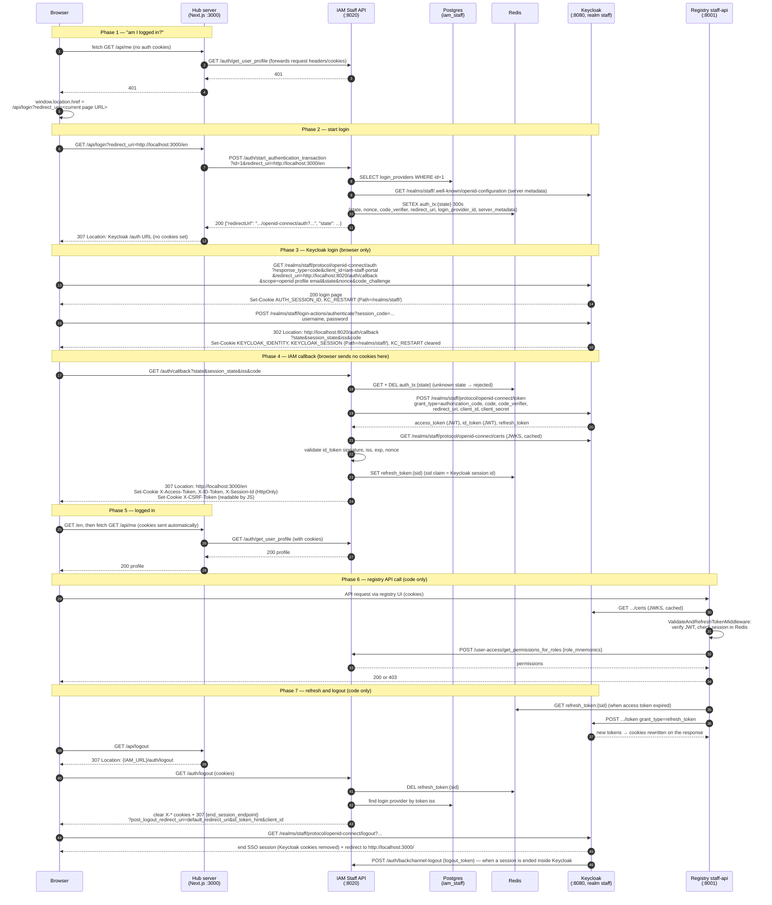

# Staff Portal Login Flow (Hub → IAM → Keycloak)

Exact login route as observed in the local openg2p-developer Docker stack on 2026-10-11.

How this was verified:

- **Live trace**: the full login was driven with `curl` against the running stack (hub `:3000`, IAM `:8020`, Keycloak `:8080`), capturing every status code, `Location` and `Set-Cookie` header, and the Redis keys before and after.
- **Code**: IAM `iam-service` (branch `1.4`, running image `openg2p/iam-staff-portal-api:1.3.0`, so small differences are possible) — `iam-core/src/iam_core/services/auth_service.py`, `services/redis_auth_transaction_store.py`, `user_auth/helpers/cookie_helper.py`, `user_auth/middleware/{validate_and_refresh,resolve_permissions,csrf,data_policy}.py`, `user_auth/adapters/`, `iam-staff-portal-api/.../controllers/{auth_controller,oauth_callback_controller}.py`, `services/application_access_service.py`, `helpers/keycloak_helper.py`. Hub (`openg2p/openg2p-staff-portal-ui:0.0.0-develop.54`) — compiled Next.js routes `.next/server/app/api/{me,login,logout}/route.js` and the `[locale]/layout` client chunk. Registry `registry-platform` staff-api `main.py` and controllers.
- **Live Keycloak and IAM database**: client settings, client scopes, roles and user role assignments were read with `kcadm.sh`; IAM tables were queried directly.

Items marked *(code only)* were read in source but not exercised in the live trace.

## Components

| Name | Container | Port | What it is |
|---|---|---|---|
| Browser | — | — | The user's browser |
| Hub UI (browser half) | `openg2p-staff-portal-ui` | 3000 | React pages running in the browser |
| Hub server (server half) | `openg2p-staff-portal-ui` | 3000 | Next.js route handlers (`/api/me`, `/api/login`, `/api/logout`) running in the same container |
| IAM Staff Portal API | `openg2p-iam-staff-api` | 8020 | Backend that talks to Keycloak, sets session cookies, owns permissions |
| Redis | `openg2p-redis` | 6379 | Stores login transactions and refresh tokens |
| Keycloak | `openg2p-keycloak` | 8080 | Identity provider, realm `staff` |
| Registry staff-api | e.g. `openg2p-farmer-registry-staff-api` | 8001 | Registry backend; validates the JWT itself via the `iam-core` library |

## Sequence diagram



## Step-by-step, with observed values

### Phase 1 — profile check

1. The hub's layout code runs `fetch("/api/me")` in the browser.
2. Hub server route `/api/me` calls IAM `GET /auth/get_user_profile`, forwarding the incoming request headers (and therefore any cookies).
3. With no cookies, IAM answers `401`; the hub passes `401` back.
4. On `401` the browser-side code navigates: `window.location.href = /api/login?redirect_uri=<encoded current URL>`.

`redirect_uri` here is the **app return URL** — the page to come back to after the whole login finishes. It is not the OAuth `redirect_uri`.

### Phase 2 — start the login transaction

5. Hub server route `/api/login` reads `redirect_uri` (default `/`) and makes a **server-to-server** call: `POST {IAM_URL}/auth/start_authentication_transaction?id={LOGIN_PROVIDER_ID}&redirect_uri=...`. Config comes from the container env: `IAM_URL=http://localhost:8020`, `LOGIN_PROVIDER_ID=1`.
6. IAM loads login provider `1` from Postgres (`iam_staff.public.login_providers`: "Keycloak Staff", client `iam-staff-portal`). If it can't, it returns `401 G2P-AUT-401 Invalid Login Provider Id` and the hub shows `{"error":"Failed to initiate auth"}`.
7. IAM fetches Keycloak's discovery document and creates a transaction in Redis:
   - key `auth_tx:{state}`, TTL **300 s**
   - fields: `state`, `nonce`, `code_verifier`, `redirect_uri` (`http://localhost:3000/en`), `login_provider_id`, `server_metadata`, `context`, `created_at`, `expires_at`
8. IAM returns `{"redirectUrl": "<keycloak auth url>", "state": "..."}`.
9. The hub server answers the browser's `/api/login` request with `307 Temporary Redirect`, `Location: <keycloak auth url>`. The hub sets **no cookies**.

### Phase 3 — Keycloak login

10. The browser follows the 307 to:
    ```
    http://localhost:8080/realms/staff/protocol/openid-connect/auth
      ?response_type=code
      &client_id=iam-staff-portal
      &redirect_uri=http://localhost:8020/auth/callback
      &scope=openid profile email
      &state=...&nonce=...&code_challenge=...&code_challenge_method=S256
    ```
11. Keycloak returns the login page and sets its own cookies (path `/realms/staff/`): `AUTH_SESSION_ID`, `KC_RESTART`.
12. The browser posts credentials to `/realms/staff/login-actions/authenticate?session_code=...`.
13. Keycloak answers `302` to IAM's callback and sets `KEYCLOAK_IDENTITY` and `KEYCLOAK_SESSION` (path `/realms/staff/`, the SSO session), clearing `KC_RESTART`:
    ```
    http://localhost:8020/auth/callback
      ?state=...            (same value IAM generated)
      &session_state=...    (Keycloak SSO session id)
      &iss=http://localhost:8080/realms/staff
      &code=...             (one-time authorization code)
    ```

### Phase 4 — IAM callback

14. The browser calls IAM's callback. **No cookies are sent**: Keycloak's cookies are scoped to `/realms/staff/`, and no IAM cookies exist yet. IAM identifies the login purely by `state`.
15. IAM reads and deletes `auth_tx:{state}` (`get_and_pop`). Unknown or expired state → rejected.
16. IAM exchanges the code server-to-server: `POST /realms/staff/protocol/openid-connect/token` with `code`, `code_verifier`, the OAuth `redirect_uri`, `client_id` and `client_secret`. The browser never sees this call or the tokens in transit.
17. IAM validates the ID token against Keycloak's JWKS (signature, issuer, expiry) and checks its `nonce` against the stored one.
18. IAM stores the refresh token in Redis as `refresh_token:{sid}`. `sid` is read from the token's `sid` claim; in the trace it equalled the `session_state` value (`dd9a6053-...`).
19. IAM responds `307 Location: http://localhost:3000/en` (the app return URL from step 7) with these headers. It first clears any old values (`Max-Age=0`), then sets:

| Cookie | Value | HttpOnly | Max-Age | Domain / Path | SameSite |
|---|---|---|---|---|---|
| `X-Access-Token` | access token JWT (RS256) | yes | 1800 | `localhost` / `/` | lax |
| `X-ID-Token` | ID token JWT (RS256) | yes | 1800 | `localhost` / `/` | lax |
| `X-Session-Id` | `sid` (= Keycloak session id) | yes | 1800 | `localhost` / `/` | lax |
| `X-CSRF-Token` | random value | **no** (JS must read it to echo it in a header) | 1800 | `localhost` / `/` | lax |

### Phase 5 — logged in

20. The browser loads `/en`; `fetch("/api/me")` now carries the cookies, the hub forwards them to IAM `GET /auth/get_user_profile`, which returns `200`.

### Phase 6 — registry API calls *(code only)*

21. The registry UI forwards the cookies to registry staff-api. Its `ValidateAndRefreshTokenMiddleware` (from `iam-core`, running inside staff-api) verifies the JWT against Keycloak's JWKS and checks the Redis session. IAM is **not** called to validate the token.
22. `ResolvePermissionMiddleware` reads the roles under the registry's own client only (`resource_access["farmer-registry-staff-portal"]`, set by `REGISTRY_STAFF_PORTAL_API_KEYCLOAK_CLIENT_ID`), calls IAM `POST /user-access/get_permissions_for_roles` with `{"role_mnemonics": [...]}`, and allows the request only if the route's `@require_permissions({...})` set is a subset of the returned permissions. Otherwise `403 Forbidden. Insufficient resource_access roles.` Routes without `@require_permissions` are allowed (`allow_by_default=True`). See [Authorization after login](#authorization-after-login).
23. Requires `REGISTRY_STAFF_PORTAL_API_AUTH_ENABLED=true` (`REGISTRY_AUTH_ENABLED=true` in openg2p-developer `.env`); otherwise the registry skips these checks.

### Phase 7 — refresh and logout *(code only)*

24. Expired access token: the middleware reads `refresh_token:{sid}` from Redis and calls Keycloak `POST /token` with `grant_type=refresh_token`, then rewrites the cookies.
25. Logout: the hub's `/api/logout` only redirects to `{IAM_URL}/auth/logout`; the hub holds no Keycloak URL. IAM deletes the Redis session, reads `iss` from the access token, finds the login provider with that issuer, takes `end_session_endpoint` from its discovery document, clears the `X-*` cookies and redirects the browser there with `id_token_hint`, `post_logout_redirect_uri` and `client_id`. Keycloak ends its SSO session too. `post_logout_redirect_uri` is always the provider's `default_redirect_uri` (`http://localhost:3000/`), whichever app the user logged out from.
    - The registry staff UI also has `KEYCLOAK_LOGOUT_URL` in its env. Not confirmed whether it uses it; if it does, it skips IAM's step and leaves the Redis session until it expires.
26. Backchannel: if a session is ended inside Keycloak (e.g. admin console), Keycloak calls IAM `POST /auth/backchannel-logout` with a `logout_token`, and IAM drops the session.

## Two sets of cookies, two sessions

| | Keycloak cookies | IAM cookies |
|---|---|---|
| Names | `AUTH_SESSION_ID`, `KC_RESTART`, `KEYCLOAK_IDENTITY`, `KEYCLOAK_SESSION` | `X-Access-Token`, `X-ID-Token`, `X-Session-Id`, `X-CSRF-Token` |
| Set by | Keycloak (`:8080`) | IAM (`:8020`) |
| Path | `/realms/staff/` | `/` |
| Purpose | Keycloak SSO session — lets the next login skip the password screen | App session — authorizes requests to hub, registries, IAM |
| Sent to apps? | No (path mismatch) | Yes, to every `localhost` port (browsers ignore ports when matching cookies) |

## What each IAM cookie is for

| Cookie | Contains | Used for |
|---|---|---|
| `X-Access-Token` | Keycloak access token (JWT): `sub`, `exp`, `iss`, `aud`, `sid`, `realm_access`, `resource_access` (roles per client) | **API authorization.** Registries verify it with JWKS and read the roles. Short-lived (Keycloak default 5 min), refreshed automatically. An `Authorization: Bearer` header is accepted instead; the cookie is the fallback |
| `X-ID-Token` | Keycloak ID token (JWT): `name`, `preferred_username`, `email`, `nonce`, `sid`, `auth_time` | **Who logged in.** Validated at the callback (signature, nonce), used for the user profile, and sent as `id_token_hint` at logout. Not used to authorize API calls |
| `X-Session-Id` | Keycloak session id (`sid`), plain text | **Pointer to the server-side session** `refresh_token:{sid}` in Redis. Used to refresh expired tokens and to revoke: deleting the Redis key ends the session even if the JWT cookies remain |
| `X-CSRF-Token` | Random value, **not** HttpOnly | **CSRF protection (double submit).** The app's JS copies it into an `X-CSRF-Token` header on `POST`/`PUT`/`PATCH`/`DELETE`; the middleware compares cookie and header (`secrets.compare_digest`). `GET`/`HEAD`/`OPTIONS` are skipped. A foreign site can make the browser send the cookie but cannot read it to set the header |

The refresh token itself is never sent to the browser.

## Two different `redirect_uri` values

| | Value | Set where | Used by |
|---|---|---|---|
| App return URL | `http://localhost:3000/en` | Hub → `/api/login` → IAM, stored in `auth_tx:{state}` | IAM, final 307 after the callback |
| OAuth `redirect_uri` | `http://localhost:8020/auth/callback` | IAM login provider config (`oauth_callback_url`) | Keycloak, to deliver the code; must be on the `iam-staff-portal` client's allow-list |

## Redis keys

| Key | Created | Deleted | TTL |
|---|---|---|---|
| `auth_tx:{state}` | `start_authentication_transaction` | `/auth/callback` (`get_and_pop`) | 300 s |
| `refresh_token:{sid}` | `/auth/callback` | `/auth/logout`, backchannel logout, or expiry | Keycloak `refresh_expires_in` |

## Troubleshooting seen locally

- **`{"error":"Failed to initiate auth"}` / hub `/api/login` 500** — IAM returned `401 Invalid Login Provider Id`. Locally this happened because Postgres hit `max_connections` (100); the celery beat containers were leaking connections. Check with `docker exec openg2p-postgres psql -U postgres -tAc "select count(*) from pg_stat_activity"`.
- **Login works but registry API calls return 401** — the registry may hold stale JWKS after Keycloak's realm was recreated (`start-dev` uses an in-container H2 database, so a recreate means new signing keys). Restart the registry staff-api.

## What is the login provider ID?

A **login provider** is a row in IAM's database (`iam_staff.public.login_providers`) that tells IAM which external OIDC identity server to log users in through, and how. It is IAM's OIDC client configuration, stored as data instead of code. The **login provider ID** is that row's primary key. A UI passes it to `start_authentication_transaction?id=...` to choose which provider to use.

The hub reads it from its container environment (`LOGIN_PROVIDER_ID=1`). Locally there is one provider:

| Field | Value | Meaning |
|---|---|---|
| `id` | `1` | The login provider ID |
| `provider_name` | Keycloak Staff | Display name |
| `server_metadata_url` | `http://localhost:8080/realms/staff/.well-known/openid-configuration` | Discovery URL. IAM derives every Keycloak endpoint from it, so `authorization_endpoint`, `token_endpoint` and `jwks_uri` are left blank |
| `issuer` | `http://localhost:8080/realms/staff` | Expected `iss` in tokens. Also used to find the provider again on token refresh (`get_by_iss`) |
| `client_id` | `iam-staff-portal` | IAM's identity at Keycloak |
| `client_secret` | (secret) | Sent only in IAM's server-to-server `POST /token` |
| `token_endpoint_auth_method` | `client_secret_post` | Secret goes in the POST body. Alternative: `private_key_jwt` with `client_private_key` |
| `scope` | `openid profile email` | What IAM requests from Keycloak |
| `enable_pkce` | `true` | Use `code_challenge` / `code_verifier` |
| `oauth_callback_url` | `http://localhost:8020/auth/callback` | The OAuth `redirect_uri` sent to Keycloak |
| `default_redirect_uri` | `http://localhost:3000/` | App return URL when the UI doesn't pass one |
| `adapter_name` | `keycloak` | Plugin that normalises provider-specific claims (e.g. `resource_access.*.roles` into a flat `roles` list) |
| `audiences` | `[]` | Allowed `aud` values; empty means not checked locally |
| `active` | `true` | Whether the provider is offered |

### Why a table

IAM can support several identity providers at once, one row each. Examples: Keycloak for staff, a national ID system (e.g. eSignet) for beneficiaries, or a social login. Each row has its own endpoints, credentials and adapter. `get_login_providers` lists the active ones (name, ID, icon) so a UI can show one login button per provider.

### Where the row comes from

With `IAM_STAFF_LOGIN_PROVIDERS_TABLE_ENABLED=true`, IAM seeds the table at startup from a JSON file:

- openg2p-developer: `templates/iam-data/login_providers.json.tpl`, rendered into `generated/iam/...`
- farmer-registry compose: `docker/local-dev/iam-login-providers.json`
- Production: rows are set per environment by the platform team

### Is it secret?

The ID is **not** secret. The row contains one secret field.

| Part | Secret? | Who can see it |
|---|---|---|
| ID (`1`) | No | Anyone who calls `get_login_providers` or IAM directly. The hub keeps it server-side, but only for convenience |
| Endpoints, issuer, `client_id`, scope, callback URL | No | They appear in the Keycloak redirect URL every browser follows |
| `client_secret` / `client_private_key` | **Yes** | IAM only. Never sent to a browser or frontend |

Knowing the ID only lets someone start a login, which means landing on Keycloak's login page. What protects the flow is the user's credentials (checked by Keycloak), IAM's client secret, PKCE and `state`, and Keycloak's redirect URI allow-list.

The local `client_secret` (`dev-iam-staff-secret`) is a plain-text default in tracked files. That's acceptable for dev only; production must load it from a Kubernetes Secret.

### Frontends are not onboarded per login provider

`start_authentication_transaction` does not identify or check the calling frontend. Any app that knows the IAM URL and a provider ID can start a login. A frontend still needs:

- a cookie domain shared with IAM, so the callback's `Set-Cookie` reaches it (`localhost` here, a shared parent domain in production)
- CORS on IAM, only if the browser calls IAM directly

What does get onboarded is **authorization**: a registry is registered in IAM as an application (`staff_portal_applications` plus roles and permissions), and gets a Keycloak client that carries its role names. Without that, a user can log in but has no permissions in that app, so requests return 403.

### Other identity providers

IAM picks provider-specific behaviour through `adapter_name` (`iam-core/user_auth/adapters/adapter_factory.py`):

| `adapter_name` | Class | Extra behaviour |
|---|---|---|
| `default_oidc` (or blank) | `OIDCBase` | Plain OIDC |
| `keycloak` | `KeycloakAdapter` | Flattens `realm_access.roles` / `resource_access.*.roles` into `roles` |
| `esignet`, `mosip_esignet` | `EsignetAdapter` | JSON-encodes eSignet's `claims` authorize parameter; merges `userinfo` claims (e.g. `individual_id`) |

To add a provider: insert a `login_providers` row (discovery URL or explicit endpoints, `issuer`, `client_id`, credential, `scope`, `adapter_name`, `oauth_callback_url`, `extra_authorize_params`), register IAM's `/auth/callback` as a redirect URI at that provider, and point the UI at the new ID. eSignet requires `private_key_jwt`: IAM signs a client assertion with `client_private_key` or a key held in MOSIP Keymanager (`keymanager_app_id`, `keymanager_ref_id`).

## Keycloak clients, redirect URIs and scopes

Live configuration of the `staff` realm:

| Client | Type | `redirectUris` | Role in the flow |
|---|---|---|---|
| `iam-staff-portal` | Confidential | `localhost:8020/auth/callback`, `localhost:3000/*`, `3001/*`, `3002/*` | **The only client used for registry and hub login.** Callback = login; UI URLs = logout targets |
| `farmer-registry-staff-portal` | Public | `localhost:3001/*` | **Holds Farmer's role names** (11 client roles). Not used for login in this flow |
| `nsr-registry-staff-portal` | Public | `localhost:3002/*` | Holds NSR's role names |
| `awe-admin-portal` | Public | `localhost:8031/*` | AWE UI logs in **directly** with `keycloak-js`; holds `AWE_ADMIN`, `AWE_VIEWER` |
| `awe-admin-resolver` | Confidential, service account only | — | AWE backend calls the Keycloak Admin API with `client_credentials` |

- **Login:** Keycloak validates only the OAuth `redirect_uri` (`/auth/callback`). The app return URL never reaches Keycloak.
- **Logout:** `post.logout.redirect.uris` is unset on every client, so Keycloak validates `post_logout_redirect_uri` against `redirectUris`. Tested live: `localhost:3000/` and `localhost:3001/` accepted, `https://evil.example/` → `Invalid redirect uri`. A new registry UI must be added to `iam-staff-portal`'s list or logout back to it fails. Side effect: those UI URLs are also accepted as login redirects for `iam-staff-portal`.
- **Backend API URLs are not registered anywhere**; Keycloak never redirects a browser to them.
- **CORS is not involved** in this login: every step is a page navigation. `webOrigins` only matters when browser JS calls Keycloak (AWE's `keycloak-js`).
- **Client scopes:** `iam-staff-portal` default scopes are `web-origins`, `acr`, `roles`, `profile`, `basic`, `email`; optional: `address`, `phone`, `offline_access`, `organization`, `microprofile-jwt`. The `roles` scope puts `resource_access` in the token, and `fullScopeAllowed: true` makes a token issued to `iam-staff-portal` carry the user's roles on **every** client — that is how one IAM login serves all registries.
- **Grant types:** standard flow (authorization code) is what login uses. Direct access grants (password grant) are **enabled** on the IAM and registry clients — useful for curl tests, should be off in production. Implicit flow is off.
- **Callback parameters** (`state`, `session_state`, `iss`, `code`) are Keycloak defaults for the code flow with `response_mode=query`. `session_state` and `iss` can be removed per client ("Exclude Session State / Issuer From Authentication Response"). On failure Keycloak sends `error`, `error_description`, `state` instead.

## Authorization after login

Keycloak answers *who you are* and *which role names you hold*. IAM answers *what those roles allow*. The registry enforces it.

| Where | Holds |
|---|---|
| Keycloak | Users, credentials, clients, **client role names**, user→role assignments. No permissions |
| IAM (`iam_staff` DB) | `staff_portal_applications` (one per registry), `staff_roles` (roles per application: Farmer 11, NSR 11), `staff_application_permissions` (72), `staff_role_permissions` (role→permission) |
| Registry code | `@require_permissions({"changeRequest:approve"})` on each route |

The IAM catalog comes from each registry's registration payload (`POST /user-access/staff_portal_applications`; locally `iam-register` / `iam-ensure-registry-variant-applications.sh`, template `iam-staff-portal-api/samples/registry_registration_payload.json`). Example entry:

```json
{ "role_mnemonic": "Intake Officer",
  "permissions": ["intakeFormDefinition:edit", "intakeFormDefinition:view",
                  "intakeSubmission:edit", "intakeSubmission:view"] }
```

The Keycloak client name must equal the IAM application mnemonic (`farmer-registry-staff-portal`); that shared name is the only link between the two systems.

Compared with the common pattern (code checks role names, e.g. `hasRole('intake_officer')`), OpenG2P code checks **permission names**, and the role→permission mapping is data in IAM, editable without redeploying.

No realm roles or composite roles are configured (only Keycloak built-ins). A cross-registry role such as "Development Agent" could be a realm composite of client roles on several registry clients; Keycloak expands composites into `resource_access`, so the registry check would see them without code changes.

**AWE is different:** it validates the JWT itself and checks role names directly (`require_role("AWE_ADMIN")`), with no IAM involvement. It merges realm roles and roles from **all** clients, so `AWE_ADMIN` on any client grants AWE admin.

## Managing roles

| Action | Where | Keycloak updated? |
|---|---|---|
| Create / delete role | IAM `/create_role`, `/delete_role` | Yes, **only if** `IAM_STAFF_KEYCLOAK_ADMIN_URL` is set. IAM calls `POST`/`DELETE /admin/realms/staff/clients/{uuid}/roles` with the **logged-in admin's own token**; on failure the IAM change is rolled back |
| Add / remove permission on a role | IAM `/create_role_permission`, `/delete_role_permission` | No (permissions live only in IAM) |
| Assign role to user | Keycloak (admin console, `kcadm add-roles`, `keycloak-init.sh`) | IAM has no code for this |
| Register a whole registry | `POST /user-access/staff_portal_applications` | No. Keycloak client and roles are created separately (`keycloak-init.sh`, `keycloak-ensure-extension-clients.sh`) |

Locally `IAM_STAFF_KEYCLOAK_ADMIN_URL` is not set, so IAM role changes never reach Keycloak.

## Data policies

Permissions decide **which actions**; data policies decide **which records** (row-level access, e.g. one region only).

| Piece | Where |
|---|---|
| Definition | IAM table `data_policies`: `policy_mnemonic`, `policy_type` (`ALLOW`/`DISALLOW`), `policy_target` (register records, geo, attribute), `register_id`, `policy_filter_expression` (JSON filter using `eq`, `in`, `between`, `startsWith`, ...) |
| Assignment | Keycloak client role `DP_<policy_mnemonic>` on the user |
| Resolution | Registry `DataPolicyMiddleware` reads `DP_*` roles from the JWT and calls IAM `/data-policies/...` for their filters |
| Enforcement | Registry services add the filters to queries (search, intake, hierarchy) |

Not exercised locally.

## Known gaps and issues found

- **Role name mismatch (local):** Keycloak has `IntakeOfficer`, `DataEditor`, ... (no spaces) on `farmer-registry-staff-portal`, but `scripts/lib/keycloak-registry-roles.sh` and IAM's catalog use `Intake Officer`. Live: `get_permissions_for_roles {"role_mnemonics":["IntakeOfficer"]}` → `{"permissions":[]}`; `["Intake Officer"]` → 4 permissions. With `REGISTRY_AUTH_ENABLED=true`, routes with `@require_permissions` should return 403 for the `staff` user. Origin of the no-space names not found (the script's create calls end in `|| true`).
- **Permission lookup is not per application** in the upstream image: `get_permissions_for_roles` matches bare role names, so the same role name on another registry can answer. The COSS farmer-registry repo (PR #85) patches staff-api to call `GET /user-access/get_application_permissions_for_user?application_mnemonic=<client_id>` instead (`docker/patches/patch_platform.py`). The running `openg2p-farmer-registry-staff-api:1.2.0` is unpatched.
- **App return URL is not validated by IAM** (1.4 source): `start_authentication_transaction` accepts any `redirect_uri`. Possible open redirect after login. Not checked in the running 1.3.0 image.
- **`/user-access/get_permissions_for_roles` is unauthenticated:** a plain `curl` returns 200. Read-only, no user data.
- **Celery beat connection leak** (Farmer `celery:1.2.0`, NSR `celery:1.0.1`): fills Postgres `max_connections` within minutes and breaks login (see Troubleshooting).
- **Keycloak data is not persistent locally:** `start-dev` with no `KC_DB` uses in-container H2; every recreate wipes the realm, which `keycloak-init` rebuilds.
